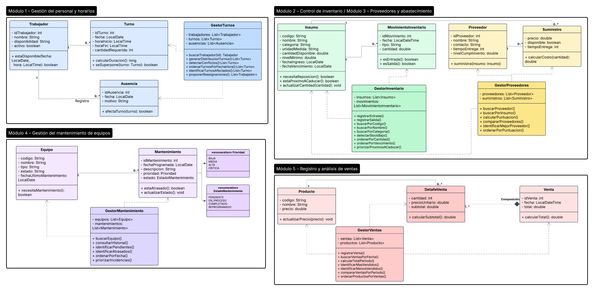

# Diagrama UML preliminar

Diagrama de clases de los 5 módulos de Yum Juice (Lucidchart):
[Ver diagrama UML](https://lucid.app/lucidchart/8ff1548b-72b6-4ba3-8d85-89c354a49008/edit?viewport_loc=-272%2C-391%2C4661%2C2100%2C0_0&invitationId=inv_083d4df2-b01c-4738-b16b-c9d7f342680c)
